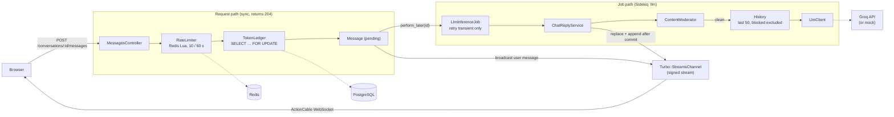

# PulseChat

**Real-time AI chat on a single Rails 8 monolith.** A user sends a message. PulseChat rate-limits it in Redis, charges tokens under a PostgreSQL row lock, moderates it before it reaches the model, generates the reply asynchronously in Sidekiq and streams it to the browser over Turbo Streams.

[](#) [](#) [](#) [](#) [](#) [](#)


*Real Groq replies. The insult never reaches the LLM. It is blocked, answered with a fixed apology and kept out of later context.*

---

## Tech stack

| Layer     | Technology |
|-----------|------------|
| App       | Ruby 3.4.4 · Rails 8.1.4 (monolith) |
| Storage   | PostgreSQL |
| Jobs      | Sidekiq 8 on Redis, queues `llm` then `default` |
| Real-time | ActionCable (Redis in dev, SolidCable in prod) · Turbo Streams |
| Frontend  | Hotwire (Turbo + Stimulus) · Tailwind · Propshaft + importmap |
| AI        | Groq through its OpenAI-compatible API (`ruby-openai`), wrapped in a mockable `LlmClient` |
| Infra     | Dockerfile + Kamal for production · k6 load harness |

---

## Architecture



**Request flow**

1. `MessagesController#create` checks `RateLimiter`, a sliding window of 10 requests per 60 s per user. Over the limit it returns `429`.
2. `TokenLedger` deducts the estimated cost (about 4 characters per token) under a row lock. If the balance is too low it returns `402`.
3. The user message is persisted as `pending` and broadcast on the conversation stream. `LlmInferenceJob` is then enqueued with the message id, and the controller returns `204`.
4. `ChatReplyService` exits early if the message is already `finished?`, then runs moderation. A blocked message gets the `blocked` status and a canned reply in one transaction.
5. Otherwise the service builds the history (last 50 messages, with blocked turns and their canned replies excluded) and calls the LLM. If the user pressed Stop meanwhile (a Redis signal or the DB status), the reply is dropped. If not, it is persisted, the message is marked `completed`, and both are broadcast.

---

## Engineering highlights

### Concurrency
- **Atomic rate limiting.** Evict, count and record run in one Lua script (`RateLimiter::SCRIPT`), not `MULTI`. The check has to run before the write, so rejected attempts are never recorded and can't keep a retrying client locked out.
- **Row-locked token ledger.** `User.lock("FOR UPDATE")` runs inside a transaction, so concurrent sends can't overdraw the balance.

### Queue reliability
- **One retry layer.** ActiveJob `retry_on` (3 attempts, polynomial backoff) is paired with `sidekiq_options retry: 0`, so Sidekiq never re-runs a job a second time on its own.
- **Transient vs terminal.** Only 5xx responses, timeouts, connection failures, 429s, deadlocks and pool timeouts are retried. Anything else is discarded. The message is marked `failed` once, after retries are exhausted. While retries are pending it stays `streaming`.
- **Thin job, logic in a service.** The job loads the record and owns retries. `ChatReplyService` owns the reply operation and can be reused and tested on its own.
- **Sized by measurement.** Concurrency is 20, from Little's law (arrival rate × LLM latency). The DB pool follows Sidekiq concurrency. The k6 + Sidekiq harness cut a 1,000-job drain from 215 s to 57 s ([report](docs/load_test.md)).

### Idempotency
- `Message#finished?` is the single list of terminal states (`completed`, `failed`, `cancelled`, `blocked`). The service returns early on it, so retries and cancels never produce a second reply.
- Writes that span several rows, such as the blocked status plus its canned reply, share one transaction. A retry can't leave a blocked message without its reply or add a duplicate.
- Broadcast errors are logged, not raised. The reply is already persisted, so a broadcast error must not trigger a retry.

### Moderation that doesn't leak
- The guard lives in `ChatReplyService`, before history is loaded and before the LLM call. A controller check would be skipped by any other reply path, and `LlmClient` is transport only.
- Blocked turns stay out of later history. Otherwise the next clean message would still send the flagged text to the provider.
- `ContentModerator` uses one precompiled whole-word regex. Everyday look-alikes ("broke", "npc") are deliberately allowed.

### Real-time ordering & scoping
- The user message goes out on the *same* stream as the job's updates, *before* the job is enqueued, so it always arrives first. Rendering it in the HTTP response raced fast jobs: a blocked reply could arrive before the message it answers.
- There are no custom channels. `turbo_stream_from @conversation` uses a signed stream name, and `ApplicationCable::Connection` rejects anonymous sockets.

### Caught by tests and measurement
- `retry_on` was dead code. The job marked messages `failed`, a terminal state, before any retry could run.
- The rate limiter counted rejected requests.
- Moderation leaked through history on the next turn.
- The expected DB pool exhaustion above 5 threads never happened, because a job holds no connection during the LLM call. The load test disproved the guess before it was "fixed".

Every guard ships with a test that fails when the guard is removed.

---

## Getting started

Requires Ruby 3.4.4, PostgreSQL 15+ and Redis 7+. No API key is needed, because replies are mocked by default.

```bash
git clone https://github.com/yehomak/PulseChat.git
cd PulseChat
brew services start postgresql@16 redis   # or any local PostgreSQL + Redis
cp .env.example .env                      # LLM_MOCK=1 by default
bin/setup --skip-server                   # gems, create + migrate + seed the database
bin/dev                                   # Puma + Sidekiq + Tailwind
```

| Service | URL |
|---------|-----|
| App     | http://localhost:3000 |
| Health  | http://localhost:3000/up |

Log in as **demo@pulsechat.dev / pulsechat-demo** (seeded in development only). Send a message, press Stop mid-generation, or call it a `dumbass` to see moderation.

### Tests

```bash
bin/rails test     # 68 tests; Redis DB 2 per worker, never the dev DB
```

### Load test

```bash
LLM_MOCK=1 bundle exec sidekiq   # the scripts refuse to run unless every llm worker is mocked
```

The scripts in `script/load/` only touch `load_*` users. See [`docs/load_test.md`](docs/load_test.md) for the method and results.

### Production

The `Dockerfile` builds the production image, deployed with Kamal (`config/deploy.yml`). Production uses SolidCable for ActionCable and ignores `LLM_MOCK`.

---

## Configuration

`.env`:

```dotenv
# ── LLM (optional: LLM_MOCK=1 works without a key)
# Canned replies with fixed latency; ignored in production
LLM_MOCK=1
LLM_MOCK_LATENCY_MS=1000
# Groq key (https://console.groq.com/keys); set it and remove LLM_MOCK for real replies
XAI_API_KEY=

# ── Workers
# Sidekiq threads; a Sidekiq process sizes its DB pool to this value
SIDEKIQ_CONCURRENCY=20
# Puma threads; web processes size their DB pool to this value
RAILS_MAX_THREADS=5

# ── Infrastructure (only if not on localhost defaults)
REDIS_URL=redis://localhost:6379/0
```

Default model: `qwen/qwen3.8-27b` on Groq, `max_tokens` 1000 (`LlmClient::MODEL`).

---

## Repository layout

```
app/controllers/messages_controller.rb   Rate limit, token charge, persist, broadcast, enqueue, cancel
app/services/
  chat_reply_service.rb                  Moderation guard → history → LLM → persist → broadcast
  content_moderator.rb                   Precompiled whole-word insult regex
  llm_client.rb                          Groq transport + LLM_MOCK
  rate_limiter.rb                        Redis sliding window (Lua)
  token_ledger.rb                        Row-locked token deduction
app/jobs/llm_inference_job.rb            Queue :llm, transient-only retries, fail after exhaustion
app/models/message.rb                    role / status enums, finished?
app/views/conversations/show.html.erb    turbo_stream_from @conversation
config/sidekiq.yml                       Concurrency + queue order
script/load/                             k6 HTTP + Sidekiq pipeline load tests
```

Project conventions for Claude Code are in [`CLAUDE.md`](CLAUDE.md) and [`.claude/`](.claude).

---

## Roadmap

- [ ] Refund tokens for blocked messages (requires storing the charged amount on the message)
- [ ] Classifier-based moderation to catch misspellings and paraphrase
- [ ] Token-by-token streaming of the LLM reply
