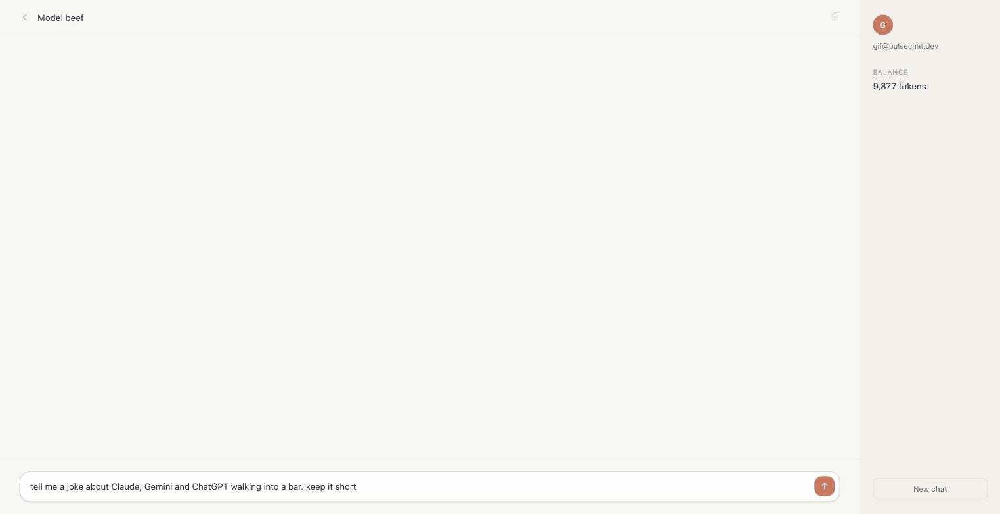
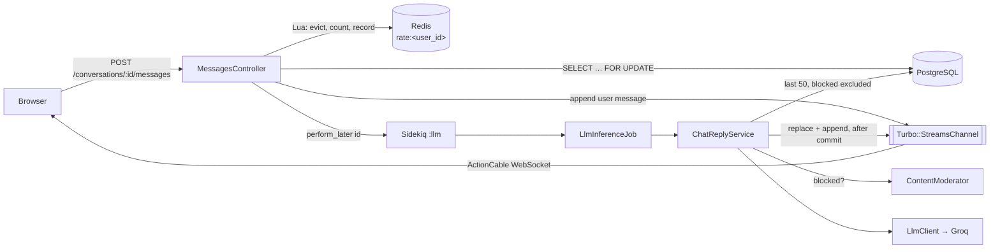

# PulseChat

**Real-time AI chat on a single Rails 8 monolith.** Messages are rate-limited in Redis, paid for
under a PostgreSQL row lock, moderated before they reach the model, answered asynchronously by
Sidekiq and streamed to the browser over Turbo Streams.



*Real Groq replies. The insult never reaches the LLM: it is blocked, answered with a fixed
apology, and kept out of later context.*

## Architecture



**Request path** (`MessagesController#create`, returns `204`):

1. `RateLimiter`: 10 requests / 60 s sliding window → `429`
2. `TokenLedger`: deduct the estimated cost under a row lock → `402`
3. Persist the user message as `pending`, broadcast it on the conversation stream
4. Enqueue `LlmInferenceJob` with the message id

**Job path** (`ChatReplyService`):

1. Return early if the message is already `finished?` (retry or cancel)
2. Moderation: blocked → mark `blocked` + canned reply in one transaction, broadcast, stop
3. Build history (last 50 messages, blocked turns and their canned replies excluded)
4. Call the LLM; drop the reply if the user cancelled meanwhile (Redis signal or DB status)
5. Persist the reply, mark the message `completed`, broadcast

The user message is broadcast on the *same* stream as the job's updates and *before* the job is
enqueued, so it always arrives first. Rendering it in the HTTP response raced fast jobs: a blocked
reply could land before the message it answers.

## Engineering highlights

### Concurrency
- **Atomic rate limiting.** Evict, count and record run in one Lua script
  ([`RateLimiter::SCRIPT`](app/services/rate_limiter.rb)), not `MULTI`: the check must precede the
  write, so rejected attempts are never recorded and can't keep a retrying client locked out.
- **Token deduction under a row lock.** `User.lock("FOR UPDATE")` inside a transaction
  ([`TokenLedger`](app/services/token_ledger.rb)); concurrent sends can't overdraw the balance.

### Queue reliability
- **One retry layer.** ActiveJob `retry_on` (3 attempts, polynomial backoff) with
  `sidekiq_options retry: 0`, so failed jobs are never re-run by a second layer.
- **Transient vs terminal.** Only 5xx, timeouts, connection failures, 429, deadlocks and pool
  timeouts retry. Everything else is discarded and the message marked `failed`, once, after
  retries are exhausted. While retries are pending the message stays `streaming`.
- **Thin job, logic in a service.** The job loads the record and owns retries;
  `ChatReplyService` owns the operation and is reusable and testable on its own.
- **Sized by measurement.** Concurrency 20 from Little's law (arrival rate × LLM latency); the DB
  pool follows Sidekiq concurrency. A k6 + Sidekiq harness cut a 1,000-job drain from 215 s to
  57 s ([report](docs/load_test.md)).

### Idempotency
- `Message#finished?` is the single list of terminal states (`completed`, `failed`, `cancelled`,
  `blocked`); the service returns early on it, so retries and cancels never produce a second reply.
- Multi-row writes (blocked status + canned reply) share one transaction, so a retry can't leave a
  blocked message without its reply or add a duplicate.
- Broadcast failures are logged, not raised: the reply is already persisted and must not trigger
  a retry.

### Moderation that doesn't leak
- The guard lives in `ChatReplyService`, before history is loaded and before the LLM call. A
  controller check would be skipped by other reply paths; `LlmClient` is transport only.
- Blocked turns are excluded from later history. Otherwise the next clean message would still send
  the flagged text to the provider.

### Real-time delivery
- No custom channels. `turbo_stream_from @conversation` uses a **signed** stream name, and
  `ApplicationCable::Connection` rejects anonymous sockets.

### Caught by tests and measurement
- `retry_on` was dead code: the job marked messages failed (terminal) before retrying.
- The rate limiter counted rejected requests.
- Moderation leaked through history on the next turn.
- Expected DB pool exhaustion above 5 threads never happened: a job holds no connection during the
  LLM call. The load test disproved it before it was "fixed".

Every guard ships with a test that fails when the guard is removed.

## Local development

Requires Ruby 3.4.4, PostgreSQL 15+ and Redis 7+. No API key needed: replies are mocked by default.

```bash
brew services start postgresql@16 redis   # or any local PostgreSQL + Redis
cp .env.example .env                      # mocked LLM replies by default
bin/setup --skip-server                   # gems, create + migrate + seed the database
bin/dev                                   # Puma + Sidekiq + Tailwind on http://localhost:3000
```

Log in as **demo@pulsechat.dev / pulsechat-demo** (seeded in development only). Send a message,
press Stop mid-generation, or call it a `dumbass` to see moderation.

```bash
bin/rails test        # 68 tests; Redis DB 2 per worker, never the dev DB
```

The `Dockerfile` is the production image (Kamal, `config/deploy.yml`); there is no Docker Compose
setup for development.

## Environment variables

```bash
# .env
LLM_MOCK=1                      # canned replies; ignored in production
LLM_MOCK_LATENCY_MS=1000        # simulated LLM latency for the mock
XAI_API_KEY=                    # Groq API key; set it and remove LLM_MOCK for real replies
SIDEKIQ_CONCURRENCY=20          # Sidekiq threads; the DB pool follows it
REDIS_URL=redis://localhost:6379/0
RAILS_MAX_THREADS=5             # Puma threads and web DB pool
```

## Stack

| Layer | Choice |
|---|---|
| Runtime | Ruby 3.4.4, Rails 8.1.4 |
| Database | PostgreSQL |
| Jobs | Sidekiq 8, queues `llm` then `default` |
| Real-time | ActionCable (Redis in dev, SolidCable in prod) + Turbo Streams |
| LLM | Groq via the OpenAI-compatible API (`ruby-openai`), wrapped in `LlmClient` |
| Frontend | Hotwire (Turbo + Stimulus), Tailwind, Propshaft + importmap |

## Source map

| Concern | Path |
|---|---|
| Request entry, rate limit, charge | `app/controllers/messages_controller.rb` |
| Reply operation + moderation guard | `app/services/chat_reply_service.rb` |
| Job and retry policy | `app/jobs/llm_inference_job.rb` |
| Rate limiter / token ledger | `app/services/rate_limiter.rb`, `app/services/token_ledger.rb` |
| Moderation / LLM client | `app/services/content_moderator.rb`, `app/services/llm_client.rb` |
| Load test | `script/load/`, [`docs/load_test.md`](docs/load_test.md) |

Built with [Claude Code](https://claude.com/claude-code) using the setup in [`.claude/`](.claude)
and [`CLAUDE.md`](CLAUDE.md).
